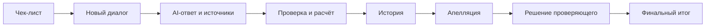
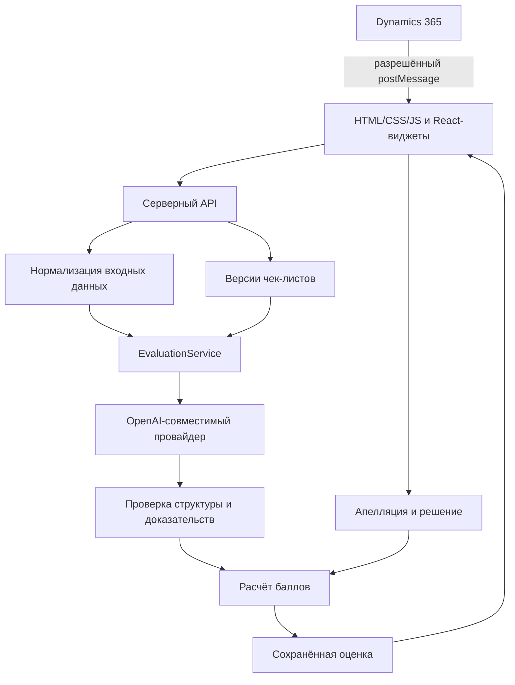

<p align="left"></p>

# FREAX CQA

**Оценка чатов и звонков по изменяемым чек-листам, с точными цитатами, историей и ручным пересмотром.**

[Открыть сервис](https://freax-cqa-workspace.imausymzhan.chatgpt.site/#service) · [Инструкция](https://freax-cqa-workspace.imausymzhan.chatgpt.site/guide.html) · [Запуск](#запуск) · [Проверка для жюри](#сценарий-проверки) · [Архитектура](#архитектура) · [Результаты](#результаты-и-границы-достоверности)

FREAX помогает проверить работу оператора: модель читает новый диалог и текущие правила, выбирает ответы и приводит доказательства. Код проверяет структуру, роли и цитаты, рассчитывает баллы и сохраняет снимок результата. Проверяющий может оспорить отдельный критерий, подтвердить либо изменить ответ с обоснованием и получить новый итог, сохранив исходную AI-оценку.

Проект подготовлен для кейса Freedom Broker на Data Challenge от NU DataSci. Входные данные поддерживают русский, казахский и английский языки, текстовые чаты и транскрипты телефонных разговоров.

Размещённая версия использует доступ по аккаунту владельца сайта. Для самостоятельного запуска доступны исходники Node.js сервера и инструкция ниже. Презентация команды: [PowerPoint, 6 слайдов](presentations/Freax-CQA-Doomsday-demo.pptx).

## Возможности

| Задача | Реализация |
|---|---|
| Получить диалоги | Один JSON, массив, ответ API организаторов или загрузка по `group_id` |
| Найти разговор | Выбор диалога, поиск по ID и словам клиента, фильтр языка, папки с загруженными материалами |
| Настроить правила | Название, инструкции, веса, шкалы, N/A, добавление и удаление критериев, сохранение новой версии |
| Оценить новый текст | Реальный вызов OpenAI-совместимого сервиса с текущим транскриптом и чек-листом |
| Проверить вывод | Точные цитаты, ID сообщений, роли и проверенные диапазоны, переход к контексту |
| Разобрать спорный ответ | Апелляция по критерию, причина решения и отдельный финальный результат |
| Сохранить историю | Снимки исходных данных, правил, ответов, источников и пересмотров |
| Оценить набор | Ограниченная параллельность, пауза, продолжение и явный повтор сбоев |
| Подготовить сдачу | Полная оценка в JSON и отдельный официальный `results.json` для DEV/PROD |
| Встроить в CRM | Адаптер iframe для Dynamics 365 с точным списком разрешённых origin |

В интерфейсе есть учебный диалог. Он явно помечен, содержит вымышленные реплики и не имеет готовых AI-оценок. Открытие примера или загрузка файла не запускают оплачиваемый запрос. Оценка выполняется только по отдельной кнопке.

## Содержание

- [Сценарий проверки](#сценарий-проверки)
- [Запуск](#запуск)
- [Оценка и доказательства](#оценка-и-доказательства)
- [Чек-листы и расчёт](#чек-листы-и-расчёт)
- [Апелляции](#апелляции)
- [Пакетная обработка и сдача](#пакетная-обработка-и-сдача)
- [API](#api)
- [Архитектура](#архитектура)
- [Dynamics 365](#dynamics-365)
- [Результаты и ограничения](#результаты-и-границы-достоверности)
- [Проверки и разработка](#проверки-и-разработка)

## Сценарий проверки

Полный цикл доступен через рабочую страницу, без изменения исходников.



### 1. Выберите правила

Откройте сервис. В блоке «Выберите чек-лист» выберите сохранённую версию. «Настроить критерии» открывает редактор. Измените инструкцию, вес или шкалу и сохраните новую версию. Прежние оценки сохранят свои исходные правила.

### 2. Загрузите новый диалог

Используйте JSON-файл или кнопку «Получить набор» с нужной группой API. Для первого знакомства можно нажать «Открыть учебный диалог». В загруженном наборе работают поиск по ID и словам клиента, выбор языка и переход к конкретному разговору.

### 3. Запустите AI

Выберите диалог и нажмите «Оценить диалог». На время настоящего запроса отображается состояние загрузки. Если за это время выбрать другой разговор, результат первой оценки сохраняется в истории и не подменяет текущий выбор.

### 4. Проверьте результат

Сначала показан финальный итог, затем исходное и финальное значения. У критериев видны объяснение и доказательства. «Показать в транскрипте» выделяет исходную реплику либо участок. Подробные веса, инструкции и параметры выполнения можно раскрыть отдельно.

### 5. Подайте апелляцию

У нужного критерия раскройте «Подать апелляцию», опишите причину и сохраните обращение. Исходный ответ, объяснение и источники фиксируются вместе с апелляцией.

### 6. Сохраните решение проверяющего

В обращении откройте «Рассмотреть апелляцию». Подтвердите либо измените ответ, укажите причину и источники, затем сохраните решение. Код пересчитает итог без нового вызова модели. Исходный AI-результат останется доступным.

Подробная инструкция для пользователей поставляется вместе с приложением: [`src/web/guide.html`](src/web/guide.html). Она открывается по `/guide.html`.

## Запуск

### Требования

- Node.js **24 или новее**.
- Настроенный OpenAI-совместимый AI-сервис для реальной оценки.
- Серверная конфигурация в `.env`.
- Исходный JSON-набор для обработки; приватные данные не входят в поставку интерфейса.

Готовые CSS и JavaScript виджетов включены в репозиторий. Для запуска Node.js сервера и основных тестов установка npm-пакетов не требуется. Для пересборки UI см. раздел разработки.

```sh
cp .env.example .env
```

В Windows можно скопировать файл средствами проводника или выполнить:

```powershell
Copy-Item .env.example .env
```

Заполните `.env` локально. Ключи не нужно помещать в HTML, браузерный JavaScript или Git.

Основные настройки:

| Параметр | Назначение |
|---|---|
| `AI_PROVIDER` | `cloud` либо `local` |
| `AI_BASE_URL` | Базовый адрес OpenAI-совместимого API |
| `AI_MODEL` | Выбранная модель |
| `AI_API_KEY` | Серверный ключ облачного сервиса |
| `AI_PROTOCOL` | `openai-chat` либо явно выбранный совместимый протокол |
| `AI_RESPONSE_FORMAT` | `json_schema`, `json_object` или другой поддерживаемый режим |
| `AI_MAX_COMPLETION_TOKENS` | Явный лимит ответа при OpenAI-протоколе |
| `AI_TIMEOUT_MS` | Тайм-аут запроса |
| `CQA_DATASET_URL` | Приватный адрес API наборов; `group_id` добавляется сервером |
| `CQA_REFERENCE_FILE` | Необязательный локальный файл с допустимыми материалами организаторов |
| `CQA_PUBLIC_ORIGIN` | Точный внешний origin приложения при запуске за HTTPS-прокси |
| `CQA_EMBED_ORIGINS` | Разрешённые origin родительской CRM |

Проверка конфигурации без запуска оценивания:

```sh
npm run prod:preflight
```

Запуск:

```sh
npm start
```

По умолчанию приложение доступно на `http://127.0.0.1:3000`. Конкретные host/port задаются серверными настройками. История и чек-листы сохраняются в каталоге данных. На один каталог должен работать один серверный процесс.

Более подробное размещение: [deployment guide](deploy/README.md). Приватные ключи, исходные диалоги и справочные материалы исключены из Git.

## Оценка и доказательства

Один запрос к модели содержит текущую версию чек-листа и текст текущего диалога. Сначала формируются факты и хронология, затем решения по критериям. Подписанная ссылка на аудио не передаётся в текстовый запрос.

После ответа выполняются отдельные проверки:

1. Структура ответа и обязательные поля соответствуют текущей схеме.
2. У каждого критерия допустимый ответ: булево значение, ступень шкалы, разрешённый N/A или явная неопределённость.
3. Цитата точно содержится в указанном исходном сообщении.
4. Роль сообщения подходит к доказательству: реплика клиента не становится заслугой оператора.
5. Границы проверенного диапазона существуют и идут в исходном порядке.
6. Применимость и специальные условия N/A соблюдены.

Ошибочная структура, выдуманная цитата, отказ модели, тайм-аут и обрезанный ответ сохраняются как ошибка. Система не заменяет их готовым числом и не делает скрытый повторный вызов.

### Чаты и телефонные разговоры

Поддерживаются `agent chat` и `voice call`. При оценке звонков текстовые требования адаптируются к устной коммуникации: логика разговора, понятность, корректность речевых формулировок. Консультация проверяется по полноте и корректности ответа клиенту.

Если в источнике есть ссылка на запись, её можно открыть. В текущей версии нет автоматической оценки темпа речи, дикции и произношения по аудио. Эти возможности не подменяются выводами из одного транскрипта.

### Источники знаний

Для оценки используются транскрипт и разрешённые материалы организаторов. Публичные FAQ, сторонние ответы и чужая разметка не подключаются как эталонные продуктовые знания. Если решающего факта нет, система должна сохранить неопределённость и указать, что требуется проверить.

## Чек-листы и расчёт

Стартовая конфигурация: [`config/checklist.v1.json`](config/checklist.v1.json).

| ID | Критерий | Тип | Вес |
|---|---|---|---:|
| 01 | Установление контакта | Да / Нет | 10 |
| 02 | Выявление потребности | Да / Нет | 15 |
| 03 | Идентификация | Да / Нет | 20 |
| 04 | Корректная и полная консультация | Шкала | 20 |
| 05 | Эмпатия и клиентоориентированность | Да / Нет | 15 |
| 06 | Управление диалогом, скорость и грамотность | Шкала | 15 |
| 07 | Завершение | Да / Нет | 5 |
| 08 | Грубые ошибки | Отдельный флаг | 0 |

Редактор позволяет изменять состав критериев, веса, инструкции, шкалы и условия применимости. Сохранение создаёт новую версию. Оценка хранит собственный снимок чек-листа, текста и параметров выполнения.

### Формула

Для применимых критериев:

```text
Итог = 100 × Σ(вес × доля выполнения) / Σ(применимых весов)
```

- «Да» даёт полный вес, «Нет» даёт ноль.
- Шкала нормируется относительно её максимальной ступени.
- N/A исключается из применимых весов; оставшиеся веса перераспределяются.
- Грубые ошибки учитываются отдельно и сами по себе не обнуляют общий итог.
- Используется точная рациональная арифметика; итог округляется один раз по `ROUND_HALF_UP` до двух знаков.

Если критерий с положительным весом не определён, глобальные веса и общий итог не рассчитываются. Известные ответы и исходные баллы сохраняются. Неопределённый флаг грубых ошибок может сосуществовать с числовым итогом, но остаётся отдельным неизвестным значением.

### Пользовательский чек-лист и официальный файл

Произвольные чек-листы разрешены для работы сервиса. Формат сдачи требует исходные восемь критериев и поддерживаемые типы/шкалы. Перед новым запросом интерфейс показывает несовместимость и предлагает явно продолжить без официальной выгрузки. Ответы не преобразуются скрыто в другую шкалу.

## Апелляции

Апелляция привязана к критерию и версии результата. Одновременно для критерия может быть открыто одно обращение. Сохраняются:

- оспариваемый ответ, объяснение и источники;
- комментарий автора обращения;
- действие проверяющего: подтверждение или изменение;
- причина, новый ответ и доказательства;
- исходный AI-итог и отдельный финальный итог.

Для сохранения решения проверяется текущая ревизия. Устаревшее изменение не должно перезаписать более новое. Пересмотр использует тот же расчёт баллов и не требует нового AI-запроса.

## Пакетная обработка и сдача

В интерфейсе откройте «Пакетная оценка». Выберите загруженный набор, сохранённый чек-лист и параллельность.

- Пауза дожидается завершения текущих задач.
- Продолжение пропускает уже законченные попытки.
- Повтор сбоев запускается отдельно, создаёт новые попытки и новые оплачиваемые запросы.
- Частичный результат не становится полным из-за повторного открытия страницы.
- История попыток и параметры прогона сохраняются.

Самостоятельный Node.js сервер выполняет очередь в запущенном процессе. Размещённый Sites-сервис обрабатывает очередь по запросам открытой страницы; вкладку нужно оставить открытой. Это разные механизмы выполнения, с одинаковой логикой оценки.

### Файлы

- **Полная оценка JSON** содержит транскрипт, снимок чек-листа, ответы, источники и апелляции.
- **Официальный `results.json`** содержит данные в контракте сдачи для DEV либо PROD.

Экспорт проверяет покрытие исходных ID, количество и каналы: 65 диалогов DEV или 10 чатов PROD. Смешивание модели, промпта, схемы и справочных материалов блокируется. Неопределённость и сбои записываются как `error`, без искусственных нулей и N/A.

Существующие файлы команды: [DEV](results/dev/results.json), [PROD](results/prod/results.json).

### CLI

Проверка совместимости без модели:

```sh
node scripts/evaluate-batch.mjs preflight --checklist config/checklist.v1.json
```

Реальный запуск набора, который выполняет AI-запросы:

```sh
node --env-file-if-exists=.env scripts/evaluate-batch.mjs start --dataset data/dev/api-response.json --checklist config/checklist.v1.json --subset dev --concurrency 2
```

Проверка готовности выгрузки без записи и без модели:

```sh
node scripts/export-results.mjs readiness --subset dev --dataset data/dev/api-response.json --evaluations-dir data --latest --checklist-version 1
```

Версия в команде должна совпадать с оценками. Для нескольких прогонов используйте явный `--run-id`. Основное представление официального экспорта - исходный AI; `--view reviewed-final` выбирается отдельно.

Проверка подготовленного PROD-файла:

```sh
node scripts/export-results.mjs validate --subset prod --dataset data/prod/api-response.json --input results/prod/results.json
```

Исходные наборы в примерах находятся в приватном каталоге `data/`; их нужно предоставить локально. Учебный диалог не входит в официальный DEV/PROD.

## API

Приложение и адаптер CRM используют тот же серверный API.

| Метод | Маршрут | Назначение |
|---|---|---|
| GET | `/healthz` | Состояние самостоятельного Node.js процесса |
| GET | `/api/status` | Конфигурация модели, набора и разрешённых возможностей |
| POST | `/api/import` | Нормализация нового JSON-диалога или набора |
| POST | `/api/datasets/import` | Получение набора по `group_id` |
| GET / POST | `/api/checklists` | Чтение и сохранение версий |
| POST | `/api/checklists/organizer-update` | Применение уточнений организаторов отдельной версией |
| GET / POST | `/api/evaluations` | История и новая оценка |
| GET | `/api/evaluations/:id` | Полная сохранённая оценка |
| POST | `/api/evaluations/:id/appeals` | Новая апелляция |
| POST | `/api/evaluations/:id/resolve` | Решение проверяющего |
| GET / POST | `/api/runs` | Просмотр и запуск набора |
| POST | `/api/runs/:id/pause` | Пауза |
| POST | `/api/runs/:id/resume` | Продолжение и явный повтор сбоев |
| GET | `/api/runs/:id/submission` | Официальная выгрузка прогона |

### Пример входного диалога

```json
{
  "conversation_id": "example-new-ru",
  "channel": "agent chat",
  "language": "RU",
  "transcript": [
    {"speaker": "client", "timestamp": "00:01", "text": "Здравствуйте! Можно задать вопрос?"},
    {"speaker": "operator", "timestamp": "00:02", "text": "Добрый день! Я Анна, специалист поддержки. Конечно, чем могу помочь?"}
  ]
}
```

Разрешённые роли: `client`, `operator`, `bot`, `system`. Сообщения бота и системы могут быть контекстом, но не автоматически засчитываются как работа оператора.

`POST /api/import` возвращает нормализованные разговоры и не вызывает модель. Для `POST /api/evaluations` передаются `conversation`, `checklist_id` и `checklist_version`. Полная ошибка запроса или статус `failed` в оценке не означают, что получен итоговый балл.

## Архитектура



| Слой | Файлы |
|---|---|
| Входные данные и проверки | [`src/domain.js`](src/domain.js) |
| Промпт, схема, транспорт | [`src/ai/`](src/ai/) |
| Расчёт | [`src/scoring.js`](src/scoring.js) |
| Оценка и апелляции | [`src/service.js`](src/service.js) |
| История и хранение | [`src/history.js`](src/history.js), [`src/store.js`](src/store.js) |
| Очередь и экспорт | [`src/batch.js`](src/batch.js), [`src/submission.js`](src/submission.js) |
| HTTP и статические ресурсы | [`src/server.js`](src/server.js) |
| Основной интерфейс | [`src/web/`](src/web/) |
| React-компоненты и мост к состоянию | [`frontend/`](frontend/) |
| Сборка виджетов | [`scripts/build-ui.mjs`](scripts/build-ui.mjs) |

В самостоятельной версии состояние хранится локально; в размещённой версии серверные функции используют хранилище сайта. Секреты остаются в серверной конфигурации, а не в браузерной сборке. Анимации и состояния виджетов не запускают AI-запросы.

## Dynamics 365

Адаптер находится в [`integrations/dynamics365/`](integrations/dynamics365/README.md).

1. Настраиваются точный адрес сервиса и разрешённый origin CRM.
2. Родитель отправляет `hello` и получает `ready`.
3. Разрешённый родитель передаёт `load-conversation`.
4. Импортированный диалог появляется в сервисе; оценка не запускается автоматически.
5. После явной оценки родителю возвращается краткое резюме результата.

Проверяются и окно-источник, и точный origin. Команды от посторонних окон и произвольный запуск платной оценки через сообщение не принимаются. В ответ не передаются приватные метаданные провайдера или весь транскрипт.

## Результаты и границы достоверности

В репозитории сохранены собственные результаты команды:

| Файл | Диалогов | Строк `ok` | Строк `error` |
|---|---:|---:|---:|
| [DEV](results/dev/results.json) | 65 | 54 | 11 |
| [PROD](results/prod/results.json) | 10 | 8 | 2 |

Это содержимое файлов сдачи, а не измерение точности. `error` означает, что строка не представлена как полная определённая оценка; её нельзя считать нулём либо подставлять прежний успешный результат.

Официальный Ground Truth для скрытых контрольных разговоров не предоставлен. Поэтому точность на нём не заявляется. Внутренние исследования, рабочие ожидания и сверки знакомого DEV доступны в [технических материалах](docs/technical-notes-archive.md); их нельзя выдавать за независимый результат на скрытой выборке.

Ограничения текущей версии:

- Автоматического акустического анализа нет; звонки оцениваются по транскрипту.
- Наличие ключа в конфигурации не гарантирует доступность конкретной модели: это проверяется настоящим запросом.
- Полнота и правильность продуктовой консультации зависят от доступных разрешённых материалов.
- Числовой итог отсутствует при неразрешённом взвешенном критерии.
- Пакет размещённого сервиса требует открытой страницы.
- Самостоятельный Node.js сервер не является готовой многопользовательской системой ролей; организация доступа задаётся окружением размещения.

## Проверки и разработка

Полный набор технических тестов:

```sh
npm test
```

Проверки покрывают арифметику, строгую схему и цитаты, частичные результаты, историю и апелляции, очередь, формальный экспорт, запуск, Dynamics, смену выбранного разговора во время ответа и доступность всех ресурсов интерфейса.

### Пересборка React-виджетов

```sh
npm ci
npm run build:ui
```

Исходники трёх интерактивных компонентов находятся в `frontend/components/`. Сборка создаёт локальные `src/web/ui-widgets.js` и `src/web/ui-widgets.css`. Они не зависят от внешнего CDN. Стеклянные папки открываются с клавиатуры и имеют меню, история поддерживает наведение и закрепление, точечный hero собирается из частиц и реагирует на курсор.

Основные формы и API-контроллер остаются в HTML и JavaScript. Компоненты получают состояние через события, поэтому не заменяют расчёт, источники и запись результатов. Анимации учитывают системный `prefers-reduced-motion` и останавливаются вне экрана.

В текущей рабочей среде нет предусмотренного инструмента браузерного просмотра. Проверки сборки, серверного API, серверного рендеринга компонентов и графа ресурсов не являются визуальной проверкой адаптивной вёрстки.

### Дополнительные материалы

- [Инструкция пользователя](src/web/guide.html).
- [Архитектура и распределение модулей](docs/architecture-and-teamwork.txt).
- [Подготовка PROD10](docs/prod-ready-2026-11-08.txt).
- [Сценарий сдачи](docs/submission-morning-guide-2026-11-08.txt).
- [Dynamics 365](integrations/dynamics365/README.md).
- [Размещение](deploy/README.md).
- [Предыдущие технические заметки](docs/technical-notes-archive.md).
